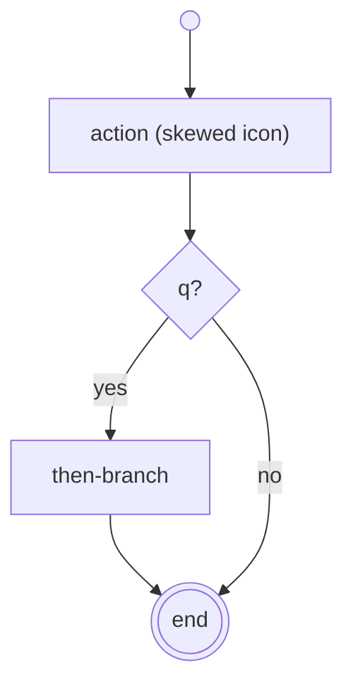

## Overview

DRAKON is a visual algorithmic language from the Russian space program,
developed for the Buran spacecraft under Vladimir Parondzhanov — flowcharts
with strict structural rules intended to be readable by engineers and
auditable by reviewers.

## Code

::code-group

::

Caption: combinations: *there is no textual syntax* — programs combine by
icon layout. This Mermaid rendering approximates DRAKON's real icons
(skewed action, question diamond, branching right); the official notation
at drakonhub stays authoritative, and the `silhouette` icon splits large
algorithms into named sub-charts.

## Distinctive traits

- One visual primitive: a fixed icon set with strict placement rules;
  execution flows top-to-bottom, branching to the right only ("the
  further right, the worse" — the diagram approximates this).
- No arrows: plain lines imply downward flow; crossings are forbidden —
  discipline is enforced by layout, not naming.
- Silhouette icons split big algorithms into named subroutines — the
  "divide and conquer" construct the rules revolve around.

## Status

Born in the Buran program (1980s, NPO Molniya), later formalized in a
Russian state standard; maintained by DrakonHub (commercial editor with a
free tier). Historical origin, present-day niche tooling.
